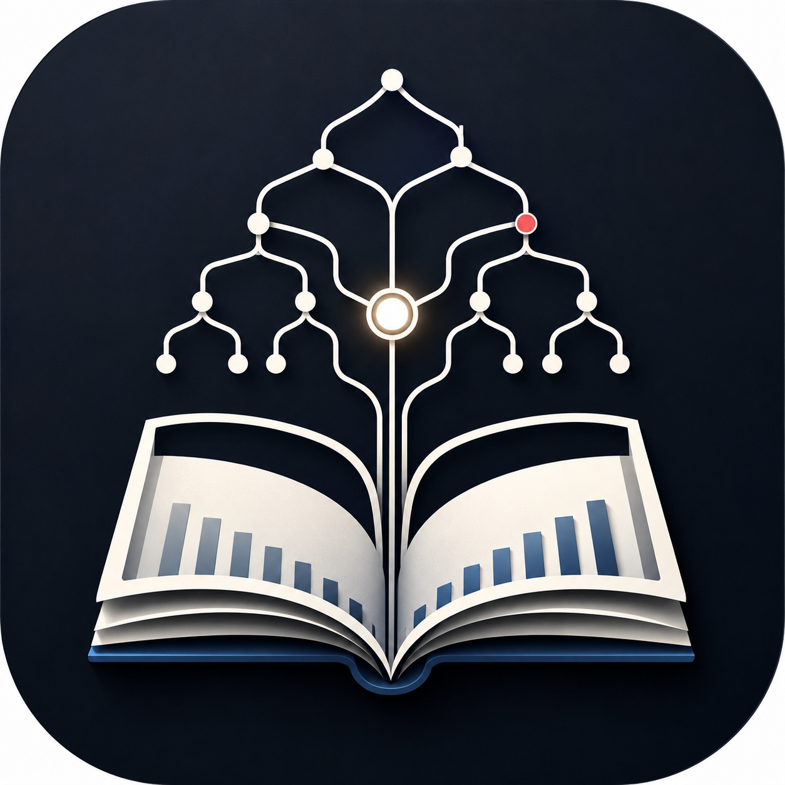

# Consulting Fundamentals Atlas

## 2026年10月20日｜秘書検定2級を「対人対応の実務力」として統合

[Consulting Study](https://silovar-uk.github.io/consultingstudy/#/cert-lab) → **学ぶ領域「秘書検定」**。既存のメニューにそのまま追加し、主要タブは増やしていません。

- **8領域・24単元・通常演習102問**（従来90問＋秘書検定の独自四択9問＋多形式3問）。別管理の段階的評価9問・PMO判断メモ2ケースは通常演習102問の対象外。
- 公式の5領域を扱う3単元：①機密・機転・補佐の権限、②敬語・傾聴・一次応答、③会議・日程・文書管理・経営用語。
- 選択問題だけでなく、**秘密情報の共有判断／会議変更の順序／苦情対応と責任者への報告**を、複数選択・順序並べ替え・記述で練習。
- PMO学習プランから**「対人対応を1問試す」**、秘書検定側から**「PMO案件で試す」**で、同じ仕事の異なる能力を往復可能。
- 既存43章との対応と秘書検定公式5領域の位置づけは「範囲と対応」に表示。受験料や日程は公式サイトを参照。
- [公式情報・ゼロベースの再リサーチ・守破離UX・未検証事項](docs/secretary-integration-research-20261020.md)
- [秘書検定のテスト](tests/cert-lab-secretary.mjs)：出題区分、旧教材保全、採点、記述式の自己点検。PC Chromium／モバイルWebKitによる実画面操作もCIで実行。

**公式の模擬試験ではなく、2級の全範囲を網羅していません。** 自動テストは正答の専門家査読、実際の応対能力の向上、iPhone Safari実機の動作を保証しません。

---

## 2026年10月20日｜守破離によるタスク中心UX

[新しい「今日」画面](https://silovar-uk.github.io/consultingstudy/) ／ [実践・資格ラボ](https://silovar-uk.github.io/consultingstudy/#/cert-lab)

- 全体の主要入口は**「今日」「探す」「実践」「記録」**の4つ。従来の教材・診断・財務ツールなどは補助メニューに保持。
- ホームの主役は**前回の続き**。ラボの最後の作業タブを記憶し、旧Atlasの利用者には最後に閲覧した章を案内。
- 「数字を読む」「判断を整理」「知識を学ぶ」「実力を確かめる」の4目的を選べば、既存の対応画面に直行。
- ラボの通常タブも4つに整理、その他の機能は折りたたみ。ラボ内の「今日」は「学習プラン」に改称。
- PMO判断メモで、デスクトップは**原資料と編集欄を左右に並べて参照**。モバイルは資料を折りたたみ・限定高さで表示。
- 主要画面は `#/cert-lab` などのURLに対応し、ブラウザの戻る・進むで画面を復元する。
- 既存の90問、新しい実力検証9問、PMO2ケースの初回提出、JSON保存形式を維持。
- [守破離による構造分析・実装内容・実機評価計画](docs/ux-shuhari-20261020.md)。

**実機iPhone Safari・VoiceOverの確認、実利用者の操作時間比較はまだ未実施。** 驚きの演出を増やす「思考の差分」は、これらの検証結果を見てから判断する。

---

## 2026年10月20日｜PMOの実務判断を証拠で確認する

[学習サイト](https://silovar-uk.github.io/consultingstudy/#/cert-lab) → **「判断メモ」** タブ。

- **能力モデル**：事実と発言、発生済みの問題と将来リスク、代替案、決裁権限、必要な追加データを区別して意思決定メモを作る。
- **原資料付きの2案件**：スポーツ映像の権利許諾／チケット在庫のデータ不整合。どちらも実在企業と無関係の架空事例。
- 初回提出を端末内に固定し、提出後にのみ具体的な参考例を示す。B案件はA提出後に開放。初回提出の自動採点や成績上昇率の表示は行わない。
- 5観点の評価者用ルーブリック（0／1／2と具体的根拠欄、重大な見落とし）を持つMarkdown評価票を保存・コピーできる。**人間による評価が終わったわけではない**。
- `state.certLab.evidencePilot` を新設し、既存90問と学習履歴・成果物に干渉しない設計。
- [一次研究・反証・次の調査計画・四代替案の評価](docs/evidence-centered-pmo-pilot-20261020.md)／[独立査読と実機受入の未完了課題](https://github.com/silovar-uk/consultingstudy/issues/6)
- 自動テスト：`node tests/cert-lab-evidence.mjs`、`node tests/cert-lab-browser.mjs`。実機iPhone Safari・VoiceOverや独立評価は未実施。

最も重要な変更は、「機能を追加した」ではなく、**どんな実務能力を観測したいのかを先に決め、証拠の残る課題を作った**こと。2事例の正答差のみでは能力向上の証明にはならない。

---

## 2026年10月20日｜学習成果を確かめる3段階パイロット

公開入口：[資格・実務ラボ](https://silovar-uk.github.io/consultingstudy/#/cert-lab) → **「実力検証」** タブ

**既存の学習問題90問は変更せず**、評価用として財務・統計・PMOの各3問、合計9問を別に追加した。主な目的は、同じ問題を覚えて正解することと、初見の別事例に対応することを分けて観察すること。

- A：解説を見ずに初回の確認に回答。
- B：判断の型を確認し、別の事例に回答。解説を表示。
- C：B回答から試行的に72時間後、まだ見ていない別事例を回答できる。待機期間は設問と解説を画面に表示しない。
- 学習履歴は既存の `state.certLab` 内に保存し、追加回答は `transferPilot` へ分離。以前の記録・成果物を維持。
- **3問の差だけで能力向上・学習効果の因果性を主張しない**。問題の難易度は独立に等化されていない。3日間隔は最適間隔ではない。
- JavaScriptが公開された静的サイトのため、厳格な不正防止・試験監督の仕組みではない。
- コード：`cert-lab-transfer-data.js`、`cert-lab-transfer-ui.js`。
- 自動テスト：`tests/cert-lab-transfer.mjs`、`tests/cert-lab-browser.mjs`（PC ChromiumとモバイルWebKit）。
- [リサーチ→再リサーチ→5層の構造化→次期評価計画](docs/transfer-pilot-research-20261020.md)
- [既存90問の機械的な監査台帳](docs/question-audit-20261020.csv)

実際の学力向上を測るには、問題の難易度、評価者間の一致度、学習者の反復測定など、追加の外部検証が必要。

---

## 2026年10月19日｜多形式の実戦演習・横断ケースを追加

[学習サイトの「実戦演習」へ](https://silovar-uk.github.io/consultingstudy/#/cert-lab)（画面内の「実戦演習」タブ）

- **問題は63問→合計90問**。新規27問＝7領域×3問の深掘り演習21問＋架空企業を使う横断ケース6問。
- **6種類の新しい問題形式**：計算入力、複数選択、手順並べ替え、実務記述、誤り訂正、単一選択。表の読み取りも含む。
- **同じ架空企業を横断**：利益率の低下→原因仮説→運転資本→新規サブスク採算→実行計画→経営会議向けメモ。
- 記述式は自己点検であり、自動採点しない。正答率に混ぜない。文章の下書き・回答履歴・評価チェックは端末内に保存。
- 既存の問題・財務ワークスペース・資格教材・43章は維持。「今日」の次の一手に応用演習をつないだ。
- [問題設計・根拠・判定仕様・検証報告](docs/question-design-v2-2026-10-19.md)
- 回帰テスト：`node tests/cert-lab-smoke.mjs`、`node tests/cert-lab-deep.mjs`、`node tests/cert-lab-browser.mjs`（Playwright）。
- 専門家査読と実機iPhone Safariによる確認は未実施。試験範囲の網羅や学習効果の実証を意味しない。

---

## 2026年10月19日｜資格・実務ラボの学習導線を再設計

公開入口：[資格・実務ラボ](https://silovar-uk.github.io/consultingstudy/#/cert-lab)

既存43章を維持しながら、資格7領域・21単元・独自63問を運用する。資格合格の可能性を判定するアプリではなく、**理解→別事例での応用→成果物→復習**を繰り返す補助ツール。

- 「今日の一手」：復習期限、現在の単元の読了、未回答問題、未作成の実務メモを踏まえて、次の一操作を選ぶ。
- 初期の42問を内容点検し、21問の選択肢を見直し。さらに21問の独自応用問題を追加した。
- 「範囲と対応」：43章の関連章と、公式試験出題範囲に対して現時点で不足する主要トピックを表示する。
- 理解に自信のない正答を申告し、翌日以降の復習へ戻せる。出題間隔は独自の簡易規則であり効果を保証しない。
- 実務成果物の下書きは端末内に保存し、別画面から戻った場合にも復元する。
- 初回利用者に架空の学習完了記録を表示しない。以前の保存済みログは保持する。
- 既存の財務ワークスペースへの導線も維持する。

**開発資料**：[調査・43章対応表・未収録分野](docs/learning-audit-2026-10-19.md)／[設計の全体像](docs/cert-lab-guide.md)

**テスト**：
- `node tests/cert-lab-smoke.mjs` — 63問のデータ整合・遷移・旧ログ互換性
- `node tests/cert-lab-browser.mjs` — Playwright（Chromium PC／WebKitモバイル相当）。PlaywrightのインストールとローカルHTTP配信が必要。
- GitHub Actionsの`Cert Lab smoke test`と`Cert Lab browser UX`で検証する。

**注意**：現在の21講義は資格試験の全出題範囲を網羅していない。受験資格や出題範囲は必ず運営団体の最新情報を確認する。ブラウザのローカルデータ消去に備え、既存の「設定・データ」からJSONバックアップを行う。

---

> コンサル一年目の実戦教科書。読む、解く、つくる、振り返るを一つにする、GitHub Pages対応の静的Webアプリ。

財務分析を中心に、問題解決・事業理解・リサーチ・資料化・プロジェクト推進までを、教科書、問題演習、成果物、学習ログとしてつなぐプロトタイプです。



## この初期版でできること

- ホーム画面で「今日やる一手」と、財務トラックの現在地を確認
- 全43章を樹形図・Gate形式で閲覧
- 財務中心の教科書画面（Chapter 7 / 8 / 9 / 12 / 13 / 15 / 18 / 21は詳細コンテンツ入り）
- 章の通過条件をチェックし、進捗を保存
- 財務ドリル、スペシャル問題、自信度、誤答タグを記録
- P/L・B/S・C/Fの数値を編集し、指標と「観察 / 解釈 / 仮説 / 確認事項」を分けて書く
- 財務診断メモをMarkdownで書き出し
- 学習ログをJSONでエクスポート / インポート
- クイックメモと章メモを成果物ライブラリへ保存
- ローカルの学習ログから、週次振り返りの下書きを生成
- iPhoneホーム画面用アイコン / Web Manifest を同梱

## まだ入れていないもの

- 本文・問題の網羅的な増補
- 実在企業の決算データ自動取得
- AI APIによる添削・学習プラン最適化
- クラウド同期・ログイン・複数端末同期
- 成果物のPDF / PPTX自動生成

この順で後から足せるよう、画面ロジックと教材データを分けています。

## GitHub Pagesで公開する手順

このリポジトリはビルド不要です。`index.html` がリポジトリ直下にあるため、そのまま静的サイトとして公開できます。

1. GitHubで新しいリポジトリを作成する
   - 例: `consulting-fundamentals-atlas`
2. このフォルダの中身を、リポジトリ直下へアップロードする
3. GitHubの **Settings → Pages** を開く
4. **Build and deployment** で、以下を選ぶ
   - Source: `Deploy from a branch`
   - Branch: `main`
   - Folder: `/(root)`
5. `Save` を押す
6. 公開URLが表示されたら、iPhone Safariで開く
7. Safariの共有メニューから「ホーム画面に追加」を選ぶ

> `public/` 配下ではなく、**リポジトリ直下**を公開対象にする構成です。GitHub Pagesで迷いにくく、ビルドも要りません。

## ローカルで確認する

Node.jsやnpmは不要です。

```bash
cd consulting-fundamentals-atlas
python3 -m http.server 8000
```

ブラウザで以下を開きます。

```text
http://localhost:8000
```

## フォルダ構成

```text
consulting-fundamentals-atlas/
├─ index.html                    # アプリの土台
├─ styles.css                    # UI / レスポンシブ対応
├─ data.js                       # 章・問題・教材のデータ
├─ app.js                        # 画面描画、進捗、保存、出力のロジック
├─ site.webmanifest              # iPhoneホーム画面向け設定
├─ .nojekyll                     # GitHub Pages用
├─ assets/
│  ├─ app-icon.png               # 元画像
│  ├─ apple-touch-icon.png       # iPhone用
│  ├─ icon-192.png
│  └─ icon-512.png
└─ docs/
   ├─ blueprint.md                # 教科書 × 学習アプリの設計書
   ├─ learning-roadmap.md         # 学習ロードマップ詳細版
   └─ content-authoring.md        # 教材を増やす時の書き方
```

## 教材を増やす方法

現在は、教材を `data.js` にまとめて入れています。プロトタイプを速く動かすためです。

増補するときは、まずこの順で進めるのがおすすめです。

1. `chapterSeeds` に章の基本情報を追加・更新する
2. `lessonDetails` に、以下を追加する
   - なぜ学ぶのか
   - 到達点
   - 重要概念
   - 例題
3. `questions` にドリル・スペシャル問題を追加する
4. 実在企業演習は、出所・公表日・単位・ページを必ず残す
5. 問題数が増えた段階で `content/finance/*.json` へ分割する
6. 本文が長くなった段階で MDX 化する

詳しいデータの型は [docs/content-authoring.md](docs/content-authoring.md) を参照してください。

## 学習ログの保存について

- 進捗・メモ・問題履歴・ワークスペース入力値は、ブラウザの `localStorage` に保存されます。
- Safariの閲覧データを消すと、ログも消える可能性があります。
- 定期的に **設定・データ → JSON出力** でバックアップしてください。
- GitHub Pagesへ公開しても、ユーザーの学習ログはサーバーへ送信されません。

## 財務演習の情報源

実在企業を題材にするときは、一次情報を起点にしてください。

- [金融庁 EDINET](https://disclosure2.edinet-fsa.go.jp/)
- [JPX 上場会社情報 / 適時開示](https://www.jpx.co.jp/listing/disclosure/index.html)

財務演習の原則は、次の4つです。

```text
1. 分母・期間・単位を必ず確認する
2. 前年 / 計画 / 競合 / 業界のいずれかと比較する
3. 数字から原因を断定せず、仮説と追加確認を分ける
4. 出所・公表日・ページを残す
```

## 次に実装すると良い順番

### Phase 2｜教材を強くする

- Gate 0〜6のドリルを各10〜20問へ増やす
- 財務以外の章にも、短問 + 成果物演習を実装する
- 章ごとの参照URL、図解、チェックリストを増やす

### Phase 3｜学習の精度を上げる

- 問題の自動採点（選択・計算問題）
- 誤答タグからの復習キュー
- 章・スキルの依存関係に基づくおすすめ
- Markdownで書いた成果物をテンプレート化

### Phase 4｜AIと同期を足す

- AIによる「観察 / 解釈 / 仮説 / 確認事項」のレビュー
- 週次のAI振り返り
- GitHub / Google Drive / Supabase 等へのバックアップ
- 成果物のPDF / PPTXアウトライン出力

## デザイン方針

- 教育アプリらしすぎず、仕事道具として使える落ち着き
- 財務の数字は「見せる」より「考える」ためのUI
- 連続日数ではなく、理解・演習・成果物・振り返りを進捗の中心に置く
- スマホでも見られるが、財務ワークスペースと成果物作成はPCで深く使える設計

---

Created for a practical learning workflow.  
Designed to grow from a static GitHub Pages app into a personal consulting learning system.


## 2026-07-04 UXアップデート

ホームを「機能一覧」ではなく、目的別の3ルートへ変更しました。

- **はじめる**：3分診断から、最初に学ぶGateと10分レッスンを提案
- **仕事に使う**：営業利益率／営業CF／在庫／競合比較を検索し、次に見る数字・原因仮説・分析メモの型を表示
- **弱点をつぶす**：正誤・自信度・誤答タグから弱点マップと次の30分メニューを表示

すべてブラウザ内保存のまま動作し、GitHub Pagesで追加の設定は不要です。
